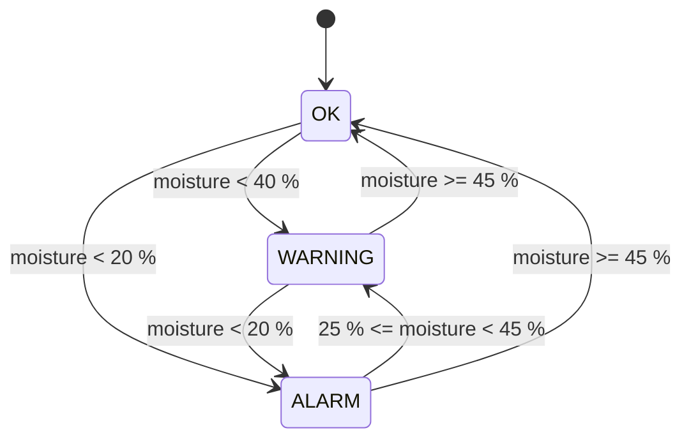

# Senior Project Roadmap (week by week)

A 12-week plan for a complete beginner, from "what is a resistor?" to a working,
documented and presented project. One short live session per week (30–45 min)
plus async questions in between. Weeks can stretch -- school, exams and life
happen; the order matters more than the dates.

Each milestone ends with a **deliverable** you can show your teacher and paste
into the project form.

| Week | Theme | You will learn | Deliverable |
|-----:|-------|----------------|-------------|
| 1 | **Safety & setup** | USB 5 V vs. mains (never touch mains), static, hot soldering irons; install Arduino IDE; create a Wokwi account | Photo/screenshot of the IDE running the *Blink* example on a board or in Wokwi |
| 2 | **Electricity basics & Ohm's law** | Voltage, current, resistance, `V = I × R`; series circuits; reading resistor colour bands | Worksheet: calculate the LED resistor (see `WIRING.md`) |
| 3 | **Breadboard** | How the rows/rails connect; LED + resistor circuit without code (5 V → R → LED → GND); using a multimeter | Working LED circuit on the breadboard + a hand-drawn schematic |
| 4 | **First sketch** | `setup()` / `loop()`, `pinMode`, `digitalWrite`, `delay`; uploading; reading compile errors calmly | Traffic-light sketch with 3 LEDs |
| 5 | **Inputs: button & Serial** | `digitalRead`, `INPUT_PULLUP`, why buttons bounce; `Serial.print` for debugging | Button toggles an LED; values visible in the Serial Monitor |
| 6 | **Sensors: analog input** | `analogRead`, 0..1023, the potentiometer as a voltage divider; calibrating a real soil/light sensor | Table of measured values (dry / wet / in between) |
| 7 | **Thinking in time: millis()** | Why `delay()` freezes everything; the non-blocking timer pattern | Blink an LED *and* read a button at the same time |
| 8 | **Actuators** | Buzzer with `tone()`, beep patterns; (optional) a small servo or relay module for a pump -- only low-voltage modules | Alarm that beeps without blocking the button |
| 9 | **Integration** | Combine sensor + thresholds + LEDs + buzzer + button; hysteresis; reading this repo's `main.ino` line by line | The full Smart Plant Monitor working on hardware or Wokwi |
| 10 | **Testing & reliability** | Why `monitor_logic.h` is separate; running the unit tests; testing edge cases with a checklist | Test log: what you tried, what happened, what you fixed |
| 11 | **Make it yours** | Pick one extension: LCD/OLED display, data logging to a spreadsheet, a second sensor, a 3D-printed or cardboard enclosure | Extension working + updated wiring diagram |
| 12 | **Documentation & presentation** | Writing the report, a clear block diagram, a 2-minute demo video, rehearsing the presentation | Completed teacher's project form, slides, demo |

## Mapping the teacher's project form

Most school project forms ask for the same sections. This is how the milestones
above fill them in:

| Typical form section | Where the content comes from |
|----------------------|------------------------------|
| Problem statement / motivation | Week 1 discussion: "plants die because nobody notices dry soil" (or your own idea) |
| Goals & success criteria | Week 9 deliverable: "warns at < 40 %, alarms at < 20 %, can be muted" |
| Background research | Weeks 2, 3, 6 notes (Ohm's law, voltage dividers, sensor types) |
| Materials & budget | `WIRING.md` parts list (≈ 15–25 € total) |
| Method / design | Wiring diagram + flowchart of `loop()` + state diagram of OK/WARNING/ALARM |
| Safety | Week 1 checklist (low voltage only, no mains, careful with water near electronics) |
| Timeline | This roadmap, with your real dates |
| Testing & results | Week 10 test log + the CSV data from the Serial Monitor turned into a chart |
| Reflection / what I learned | Short weekly journal (3 sentences after each session) |

## State diagram (for the report)

