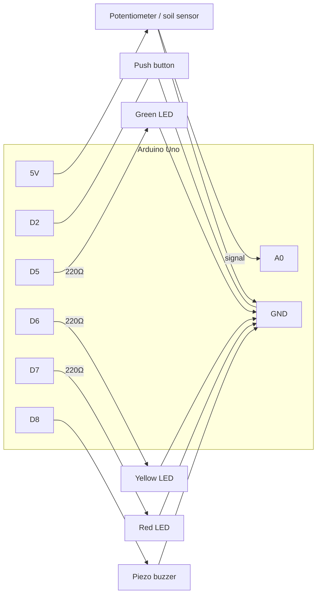

# Wiring Guide

Everything runs from the Uno's USB power (5 V). No mains voltage, no batteries
needed -- safe for a first project.

## Parts list

| Qty | Part | Notes |
|----:|------|-------|
| 1 | Arduino Uno (or compatible) + USB cable | |
| 1 | Half-size breadboard | |
| 1 | 10 kΩ potentiometer | stands in for the soil sensor while learning |
| 1 | Capacitive soil moisture sensor v1.2 (optional) | swap in later; avoid the cheap resistive fork type, it corrodes |
| 1 | Push button (tactile, 4 legs) | |
| 3 | LEDs: green, yellow, red (5 mm) | |
| 3 | 220 Ω resistors | red-red-brown bands; one per LED |
| 1 | Active or passive piezo buzzer (5 V) | |
| ~15 | Jumper wires (male-male) | |

## Pin table

| Uno pin | Connects to | Why |
|---------|-------------|-----|
| 5V | potentiometer outer leg (VCC) / sensor VCC | power for the sensor |
| GND | potentiometer other outer leg, button, LED cathodes, buzzer – | common ground (all GNDs must be connected) |
| A0 | potentiometer middle leg (wiper) / sensor AOUT | analog reading 0..1023 |
| D2 | push button (other leg to GND) | `INPUT_PULLUP`: pressed = LOW, no extra resistor needed |
| D5 | 220 Ω → green LED anode (long leg) | "soil OK" |
| D6 | 220 Ω → yellow LED anode | "getting dry" |
| D7 | 220 Ω → red LED anode | "water now!" |
| D8 | buzzer + | alarm beep (`tone()`) |

## Diagram (ASCII)

```
                 +-----------------------------+
                 |        ARDUINO UNO          |
                 |                             |
   POT VCC  ---- | 5V                      D2  | ----[ BUTTON ]---- GND
   POT SIG  ---- | A0                      D5  | ---[220Ω]---|>|--- GND   (green LED)
   POT GND  ---- | GND                     D6  | ---[220Ω]---|>|--- GND   (yellow LED)
                 |                         D7  | ---[220Ω]---|>|--- GND   (red LED)
                 |                         D8  | ---( + BUZZER - )- GND
                 +-----------------------------+

   |>|  = LED: the long leg (anode, +) faces the resistor/pin, the short leg
          (cathode, flat side of the LED) goes to GND.
```

## Diagram (Mermaid)



## Why 220 Ω? (Ohm's law, the first thing we calculate together)

An Uno pin gives 5 V. A red LED drops about 2 V and is happy at ~10–15 mA.

```
R = (V_supply - V_led) / I = (5 V - 2 V) / 0.015 A = 200 Ω  -> nearest common value: 220 Ω
```

With 220 Ω the current is about 13.6 mA -- bright enough, and well below the
20 mA recommended per pin.

## Common beginner mistakes (check these first)

1. LED backwards (nothing lights) -- flip it.
2. Forgot the shared ground -- every GND must connect to the Uno GND.
3. Button wired across the same side of the breadboard gap -- use diagonal legs.
4. Wrong board/port selected in the Arduino IDE (Tools → Board / Port).
5. Serial Monitor baud rate not set to **9600**.
